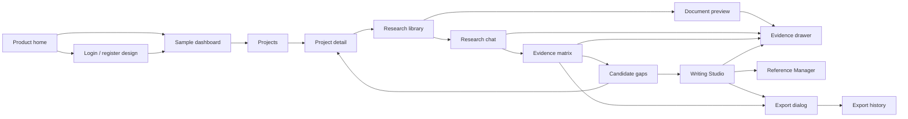

# Connected screen flows

All paths below are hash routes in the portable design, e.g. `#/literature`. A React implementation can use corresponding client routes.

## Screen inventory

| Requested screen | Design route | Principal interactions |
|---|---|---|
| Marketing landing | `#/` | Workflow sections, evidence demo, plan concepts, workspace/auth entry |
| Login / registration | `#/login`, `#/register` | Input validation, password visibility, recovery design, preview entry |
| Dashboard | `#/dashboard` | Project cards, recent papers, quick actions, activity |
| Projects list | `#/projects` | Search, local create, open project |
| Project detail | `#/project/p1` | Edit project, questions, papers, research navigation |
| Research library | `#/library` | PDF metadata selection/drop, filters, search, table/grid, ready-source selection |
| Document and evidence | `#/document/d1` | HTML page preview, highlighted excerpt, metadata edit, evidence drawer |
| Research Chat | `#/chat` | Conversation history, scope selection, citation drawers, local draft questions |
| Literature review | `#/literature` | Real editable matrix, original sample excerpts, field guide, local CSV |
| Research gaps | `#/gaps` | Source limitations, tentative interpretation, question capture |
| Writing Studio | `#/writing` | Local editor, visible save status, source markers, versions, proposal accept/dismiss |
| References | `#/references` | Missing DOI warning, style preview, duplicate review, local manual metadata |
| Export dialog/history | `#/exports` | Local CSV/HTML downloads, actual local download-request history |
| Account / usage | `#/settings`, `#/settings/usage` | Profile edit, actual local counts, honest unavailable AI usage |
| Supporting design guide | `#/design` | Tokens, screen links, state and interaction notes |

## Main journey

The main navigation stays at six task areas. References, Exports and Account Settings are secondary. Gap analysis belongs under Literature Review, not a seventh unrelated top-level product. Evidence inspection is a shared overlay, preserving context rather than forcing full-page navigation.

## Flow A — collect and inspect

Dashboard → project → library → table or grid → document → citation drawer → original document preview. The upload panel explicitly distinguishes local file selection from actual upload/processing. Existing synthetic records demonstrate Ready, Processing and Failed states; selected files are always Local only.

## Flow B — compare and challenge

Library source selection → chat scope review → illustrative answer → source excerpt → matrix comparison → inspect methods/limitations → candidate gaps → save a research question. The prewritten chat answer appears only in its original sample context. A changed scope does not relabel that answer as newly grounded.

Gap findings are tied to the AI-supported learning sample project. Other projects receive an honest empty analysis state rather than reusing unrelated findings. Broader search/verification is a visible next step before any claim of novelty.

## Flow C — develop an argument

Matrix → writing → inspect sample evidence → review a separate illustrative AI suggestion → accept or dismiss → save version → inspect history → deliberately restore if needed → references → export. A restoration first preserves the current local draft. No suggestion silently replaces text.

The prototype edits one sample manuscript introduction. Other outline entries explain the future section behavior; they do not pretend to contain saved manuscript sections. Production should use independently versioned section records and a stable full-manuscript snapshot for export.

## Flow D — references and delivery

References → missing metadata / duplicate review → deliberate manual edit → style preview → manuscript citation marker → export format selection → actual local download request → local history. DOI/BibTeX/RIS import is a disclosed design specification, not a fake import. The duplicate comparison is explicitly illustrative and offers no destructive merge of nonexistent records.

## State review

On each workspace screen, use **State** in the preview strip:

1. Ready: content and working local interactions.
2. Empty: explanatory invitation and a focused action.
3. Loading: skeleton structure and announced status.
4. Processing: named stages with no invented completion percentage.
5. Failure: safe explanation and return/recovery route.
6. Success: completion layout without claiming that a backend operation occurred.

## Manual visual acceptance

Suggested viewport widths: 1440, 1024, 768, 390 and 320px. Check navigation at the 760px breakpoint, horizontal matrix/table scrolling, evidence drawer reachability, editor/assistant stacking, auth forms, readable long titles and all six screen states. Check keyboard navigation, Escape/dialog focus return, Ctrl/Cmd+K library search, browser zoom, touch targets, reduced motion, local save/reload and download behavior.

No screenshot automation was performed. DOM tests do not replace this visual and assistive-technology review.
