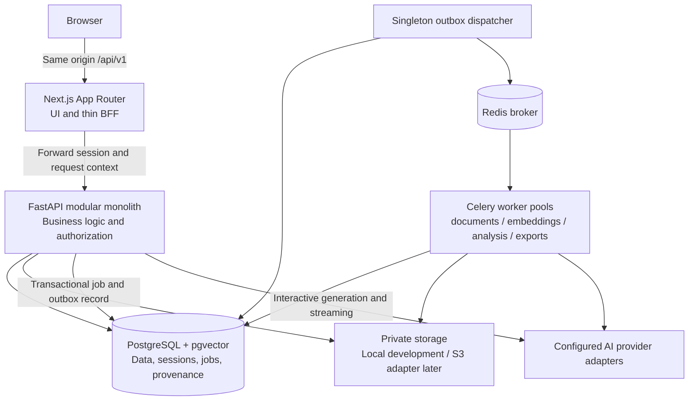
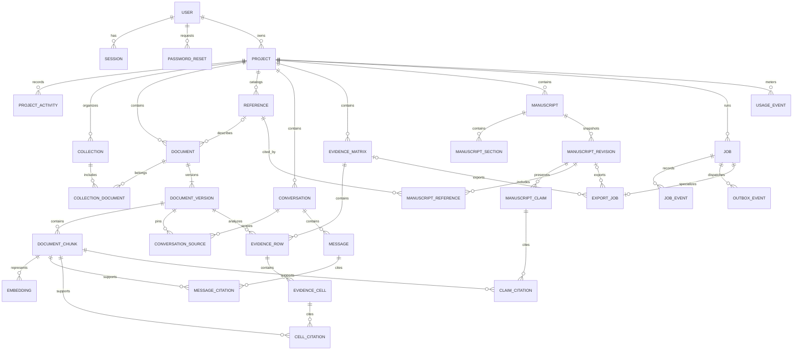

# ResearchPilot — proposed greenfield baseline

Status: proposed for approval, 18 October 2026. No application scaffold or implementation is included. Target application folder: `C:\Users\rhajr\Desktop\ResearchPilot`. The old D: application is excluded.

## 1. Final MVP requirements

ResearchPilot supports academic researchers moving from papers to evidence-supported writing. Release 1 comprises the entire workflow below; milestones deliver it incrementally rather than claiming every screen is functional on day one.

| Module | Release 1 requirements | Acceptance boundary |
|---|---|---|
| Identity | Register, log in/out, secure revocable sessions, reset passwords, edit profile | Expired/revoked sessions fail; reset tokens are single-use and expire; errors do not disclose account existence; ownership tests pass |
| Projects | Create, edit, archive/delete, research questions/objectives, recent activity | All reads/writes are owner-scoped; archived projects are read-only until restored; deletion requires explicit confirmation and documented retention handling |
| Library | PDF upload, preview, metadata, processing status, search/filter, collections, duplicates | Only validated PDFs within configured limits are accepted; duplicate upload returns an explicit result; failures are retryable where safe; originals are served only after authorization |
| Research Chat | Selected/multiple documents, streaming, citations/evidence inspection, saved conversations, abstention | Source scope is authorized before retrieval; source selection does not regenerate embeddings; final citations resolve to stored evidence; interrupted streams have explicit state |
| Literature Review | Objectives, methods, sample, theoretical framework, findings, limitations; editable matrix; comparisons, synthesis, candidate gaps | Each extracted field has evidence or an explicit missing-evidence state; edits retain original extraction/provenance; candidate gaps are labeled interpretations within the selected corpus |
| Writing Studio | Manuscripts/sections, rich-text editing, assisted drafting/rewriting, evidence-linked claims, reference insertion, autosave, revisions, DOCX | Autosave detects conflicting edits; AI proposals require acceptance; claims retain evidence links; export uses a consistent saved revision |
| References | Editable metadata, DOI lookup when configured, BibTeX/RIS import, duplicates, styles and bibliographies | Imported metadata is validated; duplicate merging is deliberate; citations use stable IDs; initial APA 7 and IEEE styles are tested, subject to style asset licensing verification |
| Exports/settings | DOCX jobs/downloads, profile, documented retention and limits | Only implemented formats appear; export authorization is checked on creation and download; resource limits are enforced server-side |

Library search initially means metadata/text filters. Semantic retrieval powers research chat; hybrid search, OCR, discovery, Zotero, collaboration, PRISMA tools, additional exports and billing are later work. No generic agent builder, external tool marketplace or workflow automation platform.

Initial assumptions: individual accounts; each project has one owner; documents belong to one project; collections belong to a project; conversations, matrices and manuscripts stay within one project. Imported references can exist without PDFs. No sharing or tenant roles yet. Document these assumptions so later collaboration is an explicit change.

## 2. Architecture



Use a single FastAPI deployment boundary and one PostgreSQL database. Workers are separate processes of the same backend codebase. This keeps local development, transactions and debugging manageable; independent services would add network and consistency problems before a demonstrated need.

Choose a same-origin, thin Next.js BFF for browser API traffic. FastAPI remains the authority for sessions, validation, permissions and persistence. The BFF forwards only allowlisted paths/headers and streams responses without buffering; it does not implement research business rules or expose backend credentials. Explicit request limits and disconnect propagation apply. Server Components may call the internal API through the same server-only client conventions.

Tradeoff: a proxy hop and careful streaming/upload handling versus a simpler browser cookie/origin model and no public cross-origin backend requirement. Test streaming and upload limits early; reconsider a dedicated same-origin reverse proxy if hosting constraints make the BFF unsuitable.

Start with synchronous SQLAlchemy sessions and synchronous database-bound FastAPI endpoints; use explicit async endpoints for streaming, keeping blocking database operations off the event loop. Workers create independent synchronous sessions. This avoids two persistence stacks initially; reconsider async database access after measured concurrency pressure. Never share a session across tasks or threads.

Use one small generation adapter and a separate embedding adapter. Select the initial provider after checking credentials, data handling requirements and current model capabilities. No silent provider fallback. Lock a verified compatible dependency set at scaffold time rather than guessing versions in this design.

## 3. Module dependency rules

| Module | Owns | Allowed business dependencies |
|---|---|---|
| identity | Users, sessions, password resets | None |
| projects | Project lifecycle, collections, activity | identity contracts |
| documents | Originals, versions, chunks, embeddings, processing | projects, identity contracts |
| references | Bibliography records, DOI/import/formatting | projects; documents contracts for associations |
| retrieval | Authorized search and evidence resolution | documents, projects contracts |
| conversations | Conversations, turns, scope and streamed answers | retrieval, projects, identity contracts |
| literature | Evidence matrices, extraction and synthesis | retrieval, documents, projects contracts |
| writing | Manuscripts, sections, revisions, claims | retrieval, references, projects contracts |
| exports | Export job lifecycle and renderers | writing/literature/reference read contracts |
| usage | Append usage events and enforce budgets | identity/project identifiers, no reverse business calls |

All modules may use narrow infrastructure adapters for database, storage, AI and queue access. Usage is a leaf dependency called by operations; it does not import their services. Shared core contains configuration, error/request context and security primitives, not a miscellaneous business-logic folder.

Routes validate transport input and call application services. Services own transactions and invariants. Repositories are introduced only when queries warrant them. Workers call services rather than HTTP routes. Other modules do not import private repositories, change foreign-owned rows or bypass authorization through direct model access. Use explicit public functions and typed results; database foreign keys may cross module boundaries without granting write ownership. Enforce prohibited imports with a lightweight dependency check once modules exist.

## 4. Initial ER diagram

This is the proposed Release 1 model, not an instruction to create every table in the first migration. UUID v4 identifiers are generated by the application; timestamps are timezone-aware UTC. Each project-scoped table carries project scope where necessary to enforce composite foreign keys and efficient authorization.



Key constraints and policies:

- Session/reset tables store hashes of random tokens, expiry and revocation/consumption state. Raw tokens are never persisted.
- Projects link to owner users; child resources must belong to that project. Validate every referenced resource, including IDs embedded in rich-text JSON.
- Original PDF identity: project-scoped unique content SHA-256 on document versions, plus document/version-number uniqueness. A duplicate returns the existing authorized version; no cross-user duplicate disclosure.
- Chunk identity includes version, extraction/chunking configuration fingerprint and ordinal. Embedding identity includes chunk, provider/model, dimensions and configuration fingerprint. Fixed vector dimension/index is selected after the first embedding model; dimension changes require a migration or explicit new index strategy.
- Collections/document associations use composite keys to prevent cross-project membership. References have normalized DOI uniqueness within a project when DOI is present; fuzzy matches are suggestions, not automatic merges.
- Citation records retain chunk IDs, page/offset locations and supplied excerpt; an ID match validates linkage, not the truth of a claim.
- Evidence cells retain original extraction, editable value, revision counter, status, model/configuration and provenance. Structured JSON holds bounded field results; citation relations remain explicit.
- Manuscript content uses validated editor JSON. Immutable manuscript revisions preserve section content, reference metadata snapshots and stable claim IDs; optimistic version checks prevent silent autosave overwrites.
- Job records hold type, target, state, attempt count, progress, heartbeat, lease, limits and sanitized failure. Target foreign keys are defined when each job type is introduced, not unvalidated arbitrary IDs. Export jobs require exactly one supported input target.
- Durable outbox rows are committed with job state. Usage events include operation/request ID, provider/model, measured tokens where supplied, latency and versioned cost estimate. Unknown usage/cost stays unknown.
- Restrict deletion of evidence that is referenced by retained outputs. Offer archive or an explicit impact-reviewed permanent purge. Purge removes dependent data and schedules idempotent private-file cleanup; backups follow documented retention. No blanket cascading deletion of research evidence.

## 5. API contract outline

All endpoints use `/api/v1`. JSON resources use UUIDs, UTC ISO timestamps and explicit schemas. Collections use opaque cursor pagination (`items`, `next_cursor`) with stable ordering and bounded page size. Errors use `application/problem+json` with `type`, `title`, `status`, safe `detail`, `instance`, `request_id` and optional field errors.

| Area | Proposed endpoints |
|---|---|
| Identity | `POST /auth/register`, `/auth/login`, `/auth/logout`, `/auth/password-reset/request`, `/auth/password-reset/confirm`; `GET/PATCH /me`; `GET /auth/csrf` |
| Projects | `GET/POST /projects`; `GET/PATCH/DELETE /projects/{id}`; `POST /projects/{id}/archive`, `/restore`; `GET /projects/{id}/activity` |
| Library | `GET/POST /projects/{id}/documents`; `GET/PATCH/DELETE /documents/{id}`; `GET /documents/{id}/versions`, `/processing`, `/preview`, `/original`; `POST /documents/{id}/retry` |
| Collections | `GET/POST /projects/{id}/collections`; `PATCH/DELETE /collections/{id}`; `PUT /collections/{id}/documents` |
| Retrieval | `POST /projects/{id}/retrieval`; `GET /documents/{id}/chunks/{chunk_id}` |
| Conversations | `GET/POST /projects/{id}/conversations`; `GET/PATCH/DELETE /conversations/{id}`; `PUT /conversations/{id}/sources`; `GET/POST /conversations/{id}/messages`; `GET /messages/{id}/events` |
| Literature | `GET/POST /projects/{id}/matrices`; `GET /matrices/{id}`; `POST /matrices/{id}/analyses`; `PATCH /matrices/{id}/cells/{cell_id}`; `POST /matrices/{id}/syntheses`, `/gap-analyses` |
| Writing | `GET/POST /projects/{id}/manuscripts`; `GET/PATCH /manuscripts/{id}`; `PUT /manuscripts/{id}/sections/{section_id}`; `GET/POST /manuscripts/{id}/revisions`; `POST /manuscripts/{id}/draft-proposals` |
| References | `GET/POST /projects/{id}/references`; `PATCH/DELETE /references/{id}`; `POST /projects/{id}/reference-imports`, `/doi-lookups`, `/reference-merges`; `GET /manuscripts/{id}/bibliography` |
| Jobs/exports | `POST /projects/{id}/exports`; `GET /jobs/{id}`; `POST /jobs/{id}/cancel`; `GET /exports/{id}/download` |
| Operations | `GET /health/live`, `/health/ready`; OpenAPI document; authenticated usage summary when implemented |

Long-running operations return `202` with a durable job ID; this means accepted, not completed. Cancellation is cooperative; unsupported transitions return conflict. Requests that enqueue work accept an owner-scoped idempotency key and reject reuse with a different payload.

Streaming: create a persisted pending message with an idempotent POST, then subscribe to an authenticated same-origin event stream. Events are typed (`status`, `delta`, `evidence`, `completed`, `failed`) with event IDs. Streamed text is provisional until final citation validation; completion is persisted before its final event. A reconnect resumes stored progress where supported and never triggers duplicate generation. Bound stream duration and concurrency; disconnect/cancellation policy is explicit.

Use expected revision/`If-Match` for manuscript and extraction edits; return `409` or `412` on conflicts. Generate frontend client/types from checked OpenAPI; CI detects drift. Multipart uploads and streaming require explicitly typed client helpers.

## 6. Frontend sitemap

```text
(auth)
  /login
  /register
  /forgot-password
  /reset-password
(dashboard)
  /dashboard
  /projects
  /projects/new
  /projects/[projectId]                  overview, questions, activity
  /projects/[projectId]/library          documents and collections
  /projects/[projectId]/library/[documentId]
  /projects/[projectId]/chat
  /projects/[projectId]/chat/[conversationId]
  /projects/[projectId]/literature
  /projects/[projectId]/literature/[matrixId]
  /projects/[projectId]/writing
  /projects/[projectId]/writing/[manuscriptId]
  /projects/[projectId]/references
  /projects/[projectId]/exports
  /settings/profile
  /settings/security
```

Primary navigation follows the requested Dashboard, Projects, Library, Research Chat, Literature Review and Writing Studio. Project-specific navigation requires a selected project; selection is visible and persists in URLs. References, Exports and Settings are secondary. No sample counts, fake jobs or functioning-looking unimplemented actions.

Server Components provide layout and appropriate initial reads; localized Client Components handle uploads, chat streams, matrix editing and manuscript editing. TanStack Query owns interactive server state; component state owns transient UI. Avoid copying the same resources into a second global store. React Hook Form/Zod support interactive form validation; backend validation remains authoritative.

White surfaces, navy text, restrained blue and light gray; semantic tokens define color, spacing and typography. Accessible labels, keyboard controls, visible focus, contrast and responsive layouts are acceptance requirements. Evaluate Tiptap using a small editor spike for stable citation nodes, schema validation, accessible editing, JSON persistence and DOCX conversion before committing to it.

## 7. Security baseline

- Argon2id password hashes; tune cost against measured deployment capacity. Rate-limit registration, login, reset, uploads and expensive generation. Reset email delivery uses a local development mail sink and a configured production adapter; never pretend an email was sent.
- Opaque server-backed sessions in HttpOnly cookies. Production cookies are Secure, SameSite=Lax, Path=/ with no Domain; use a production `__Host-` name. Local HTTP uses a distinct development configuration. Rotate session at login/security changes, bound absolute/idle expiry and revoke on logout/password reset.
- CSRF tokens tied to the session plus strict Origin validation for state changes, including authentication flows. SameSite alone is insufficient. Production API stays private to the same-origin entrypoint; CORS is disabled unless a concrete external client requires it.
- Authorize ownership in services and retrieval queries, not just route navigation. Test guessed IDs and cross-project/cross-user associations. Unauthorized resource lookups do not disclose existence.
- Validate file signatures and parseability, size/page/time/memory limits and private generated storage keys. Process PDFs in non-root resource-limited workers; disable unnecessary network access. Serve previews as isolated content with restrictive headers and sandboxing; no public upload paths.
- AI receives authorized selected evidence only. Treat document instructions as untrusted data; no arbitrary tools, shell or external network access. Validate structured outputs and citation linkage, evaluate faithfulness and label interpretation separately. Prompt instructions alone are not a security boundary.
- Reserve/enforce operation budgets before calls, bound output/context and concurrent requests, reconcile usage after completion and release reservations on failure. No automatic privacy/cost-changing fallback.
- Redact cookies, passwords, reset/session tokens, provider keys and document text from logs. Request/job IDs, safe error categories and timings support diagnosis without leaking content.
- Secrets stay server-side and outside Git/public frontend variables. Production HTTPS, security headers, dependency scanning, least-privilege database/storage credentials, migration review and tested backup restoration are release gates.
- Define retention, deletion and AI-provider data handling before external users upload real research. Upload-derived deletion and backup retention have distinct documented timelines.

## 8. Worker topology

| Queue | Responsibility | Initial execution policy |
|---|---|---|
| documents | Validate/extract/normalize/chunk | Resource-bounded parsing, low concurrency |
| embeddings | Embed persisted chunks | Provider-aware batching, rate and cost bounds |
| analysis | Literature extraction/synthesis/gap candidates | Checkpoints per paper/field, schema/evidence validation |
| exports | Render saved revisions to DOCX | Private temporary workspace, stable input snapshot |

Development can use one worker consuming four routed queues. Production can run a separate worker pool for each; separate queues do not require four containers on day one. Run exactly one scheduler/dispatcher process initially; scheduler does not live inside every worker replica.

PostgreSQL is authoritative for `queued → running → completed/failed/cancelled`. Redis delivery is at least once: unique job keys, database leases and idempotent writes make repeats safe. Commit job/outbox atomically, publish then mark delivered; a crash can duplicate delivery and must not duplicate results. Dispatcher recovery republishes pending outbox records. Reconcile expired leases using heartbeats and explicit attempt policy.

Set task-specific soft/hard timeouts and bounded retries with backoff/jitter. Retry transient failures only; malformed PDFs or invalid output need clear failure handling. Check cancellation between bounded units. Track queue age, attempts, lease expiry and duration. Worker messages contain identifiers rather than document text or credentials. Exports and model calls have explicit budgets and provenance.

## 9. Implementation milestones

| Milestone | Working outcome and completion gate |
|---|---|
| 0 — approve baseline | Agree this scope, ownership, diagrams and tradeoffs; record decisions as ADRs |
| 1 — scaffold and first vertical feature | Next.js strict TS and FastAPI, locked dependencies, PostgreSQL/Redis/Celery wiring, migration runner, health checks, CI; complete register → login → protected profile → logout with real DB sessions, CSRF/rate limits and authorization tests; minimal accessible auth UI |
| 2 — identity completion and projects | Password reset/mail sink, profile edit; project CRUD/archive and activity; ownership and migration tests |
| 3 — PDF library | Private upload/download/preview, versions, deduplication, collections, durable processing state and extraction; tests cover malformed files, concurrent duplicates and retry/restart behavior |
| 4 — retrieval and research chat | One configured provider, model/version-aware embeddings, scoped retrieval, persisted streaming chat/citations and abstentions; curated retrieval/generation evaluations and cross-user tests |
| 5 — literature analysis | Evidence-backed editable matrix, comparisons/synthesis and candidate gaps; checkpoint/retry/cost tests and provenance review |
| 6 — writing persistence | Editor spike decision, section editing/autosave/conflict handling, immutable revisions; evidence-linked AI proposals and reference-node contracts |
| 7 — references and DOCX | BibTeX/RIS import, DOI lookup, deliberate deduplication, approved citation styles and bibliography; real DOCX export from saved revision with rendering/interoperability checks |
| 8 — release hardening | Complete workflow test, RAG thresholds established from baseline, security/dependency review, restore drill, observability and deployment runbook; user performs visual acceptance |

Security, usage bounds and tests are part of every milestone, not postponed until milestone 8. No duration or scale promise is made before measuring implementation work and provider behavior.

First vertical feature acceptance: a new user registers, logs in, reloads a protected profile, updates their display name and logs out; subsequent access with that revoked session is rejected. Include invalid input, duplicate registration, CSRF failure, rate limit, expiry and cross-user profile isolation checks. It proves UI → BFF → API → database → authorization end to end without paying for AI calls. Password reset is the immediately following identity slice, not represented as complete by this feature.

Verification: backend Ruff/type checks, meaningful service/API tests and disposable PostgreSQL/Redis integration; frontend lint/strict types/component tests and production build; migration-to-head/model parity; worker redelivery/recovery tests as workers become active. User performs visual UI testing; no browser screenshot automation. CI generates synthetic data only and never resets a developer or production database.

After approval maintain `PRD.md`, `ARCHITECTURE.md`, `DATABASE.md`, `API.md`, `SECURITY.md`, `ROADMAP.md`, `PROJECT_STATUS.md` and focused ADRs in the new repository. Initial ADRs: modular monolith, BFF/session strategy, synchronous initial persistence, durable outbox jobs, evidence/version identity and editor choice after evaluation.

## Decisions to revisit with evidence

The monolith reduces operational burden but requires enforced module boundaries. The BFF simplifies origin/session handling but needs streaming validation. Database-backed opaque sessions simplify revocation but add a lookup. Durable outbox/jobs add code but prevent lost work at database/broker boundaries. A structured editor supports citations and export but requires schema/version discipline. One provider lowers integration cost but creates provider dependence; the narrow adapters provide an exit without pretending capabilities are identical.

Approval requested for this baseline and milestone 1 scaffolding in the Desktop folder. Provider/model, production host, mail delivery and retention values remain implementation/deployment decisions; they do not block the first identity feature.
