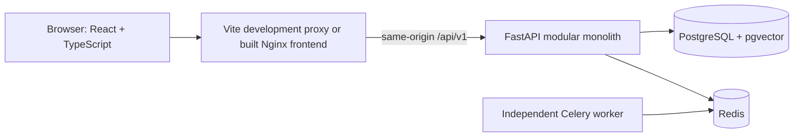

# Current architecture — foundation

18 October 2026. See ADR 0002 for the approved frontend change and `LATEST_MASTER_REQUIREMENTS.md` for product scope.

Vite compiles the frontend; Nginx serves the built files and proxies API requests. FastAPI owns validation, authentication, authorization and persistence. PostgreSQL stores users and hashed sessions. Redis stores rate-limit counters; Celery is wired and healthy, with no fake document tasks.

Active frontend routes cover home, register, login, dashboard, profile, project lists, creation, details and editing. TanStack Query caches authenticated profile data in memory; logout clears that cache. No passwords/session tokens are stored in localStorage. The separate design export intentionally uses synthetic local data and is not part of the live account application.

Long-running document/RAG work is not implemented yet. Keep future modules behind explicit services and scoped contracts, and introduce durable jobs/outbox when actual background processing begins.

## Projects slice

`app/modules/projects` now owns project metadata, questions/objectives and activity. Routes inject the current user/database and delegate to services. Services own transactions, authorization, idempotency and lifecycle rules; models/constraints protect persistence invariants. React feature components consume generated API types and refresh server-state queries after successful operations.

No Celery task is needed for a short project transaction. The document-processing slice will introduce durable jobs/outbox and storage after project context is established. See `learning/01-research-projects.md` for the code walkthrough and ADR 0003 for tradeoffs.

## Private original storage — 19 October 2026

`app/modules/documents` implements upload/list/metadata/download within owned projects. An API-only `papers` named volume stores UUID-addressed originals through LocalStorage. PostgreSQL stores immutable metadata, project-scoped checksum uniqueness and activity. Raw upload streaming is bounded; finalization shares the project lifecycle lock. Migration 0003 adds documents without rewriting applied migrations. React's project library uses generated types and real server state. No Celery tasks run yet: Stored does not mean parsed or indexed. See ADR 0004 and learning/02-private-pdf-library.md.

## Current processing phase — 19 October 2026

The storage-only boundary above is superseded by durable extraction. Upload → PostgreSQL document + job (one transaction) → separate dispatcher → Redis/Celery → worker → checksum + bounded parser subprocess → PostgreSQL page text + completion activity (one transaction). The worker mounts originals read-only. Job rows serve as durable outbox intent; redispatch, claims, leases and fencing provide at-least-once safety. Polling updates the library; an owned evidence endpoint returns one physical PDF page at a time. API readiness and processing health are separate: originals can stay queued during a worker outage. No provider/embeddings/RAG/OCR runs yet. See ADR 0005 and learning/03-durable-pdf-processing.md.
