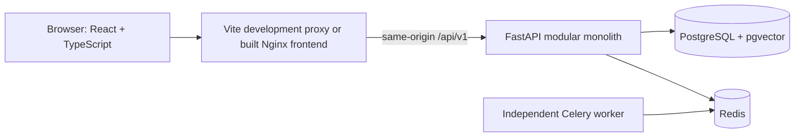

# Current architecture — foundation

18 October 2026. See ADR 0002 for the approved frontend change and `LATEST_MASTER_REQUIREMENTS.md` for product scope.

Vite compiles the frontend; Nginx serves the built files and proxies API requests. FastAPI owns validation, authentication, authorization and persistence. PostgreSQL stores users and hashed sessions. Redis stores rate-limit counters; Celery is wired and healthy, with no fake document tasks.

Active frontend routes are home, register, login, dashboard and profile. TanStack Query caches authenticated profile data in memory; logout clears that cache. No passwords/session tokens are stored in localStorage. The separate design export intentionally uses synthetic local data and is not part of the live account application.

Long-running document/RAG work is not implemented yet. Keep future modules behind explicit services and scoped contracts, and introduce durable jobs/outbox when actual background processing begins.
