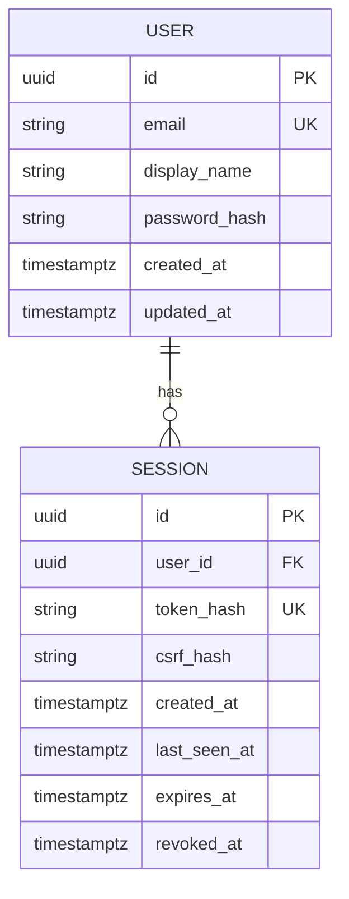
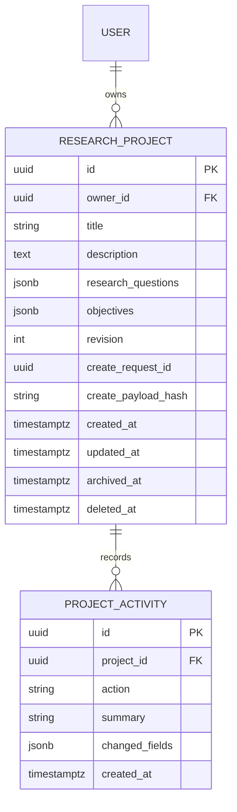

# Implemented database foundation

Migration chain: `0001` creates the vector extension and identity tables; `0002` adds research_projects and project_activities. Other future research tables remain conceptual.

Application-generated UUIDs; UTC timestamps; owner foreign key; normalized email uniqueness; session hash uniqueness; indexes on owner/expiry. Passwords use Argon2id; bearer session secrets are never stored raw. A session has absolute and idle expiry and explicit revocation.

Tests run only with environment=test and a database ending in `rp_greenfield_test`. They migrate to head, compare model/migration metadata and use synthetic accounts. These checks are not a production backup/restore or concurrency certification. Application volumes use the independent `researchpilot_greenfield` Compose project name and must not be reset to fix migrations.

## Project model

Unique owner/request ID, positive-revision check, owner/created/id and project/created/id indexes, RESTRICT foreign keys. A project deletion is a timestamped state transition, not a cascade. Read/update queries enforce owner and nondeleted state. JSONB arrays are replaced as complete bounded values when edited; they are not independent question entities yet.

The disposable test suite verifies model/migration parity, simultaneous creation, competing stale edits, transaction rollback, and soft-delete retention. Local application migration to 0002 is additive; existing users/sessions remain intact.
