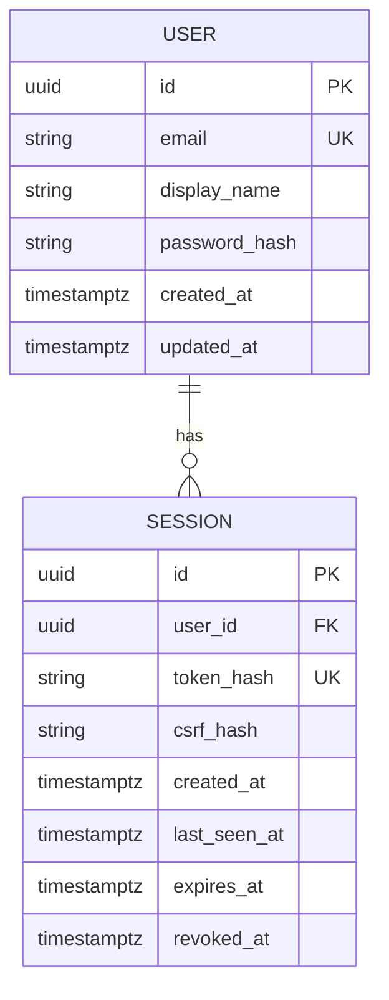

# Implemented database foundation

Migration `0001` creates the vector extension and two identity tables. Future conceptual research tables from the approved baseline are not prematurely created.

Application-generated UUIDs; UTC timestamps; owner foreign key; normalized email uniqueness; session hash uniqueness; indexes on owner/expiry. Passwords use Argon2id; bearer session secrets are never stored raw. A session has absolute and idle expiry and explicit revocation.

Tests run only with environment=test and a database ending in `rp_greenfield_test`. They migrate to head, compare model/migration metadata and use synthetic accounts. These checks are not a production backup/restore or concurrency certification. Application volumes use the independent `researchpilot_greenfield` Compose project name and must not be reset to fix migrations.
