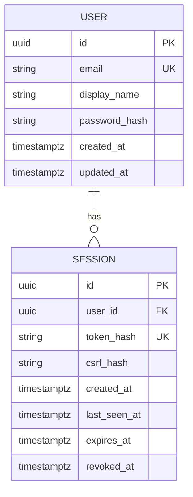
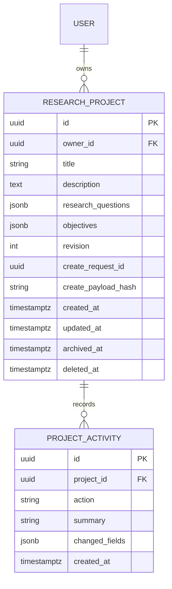

# Implemented database foundation

Migration chain: `0001` creates the vector extension and identity tables; `0002` adds research_projects and project_activities. Other future research tables remain conceptual.

Application-generated UUIDs; UTC timestamps; owner foreign key; normalized email uniqueness; session hash uniqueness; indexes on owner/expiry. Passwords use Argon2id; bearer session secrets are never stored raw. A session has absolute and idle expiry and explicit revocation.

Tests run only with environment=test and a database ending in `rp_greenfield_test`. They migrate to head, compare model/migration metadata and use synthetic accounts. These checks are not a production backup/restore or concurrency certification. Application volumes use the independent `researchpilot_greenfield` Compose project name and must not be reset to fix migrations.

## Project model

Unique owner/request ID, positive-revision check, owner/created/id and project/created/id indexes, RESTRICT foreign keys. A project deletion is a timestamped state transition, not a cascade. Read/update queries enforce owner and nondeleted state. JSONB arrays are replaced as complete bounded values when edited; they are not independent question entities yet.

The disposable test suite verifies model/migration parity, simultaneous creation, competing stale edits, transaction rollback, and soft-delete retention. Local application migration to 0002 is additive; existing users/sessions remain intact.

## Migration 0003 — stored originals

`documents`: UUID id, project_id RESTRICT FK, filename(180), sha256(64), byte_size (1–20971520), created_at with timezone. Unique(project_id, sha256); index(project_id, created_at, id). Ownership derives from the parent project. No parsing/job/version/chunk rows exist yet. Original storage key is derived from the UUID and is not caller supplied. File and database publication are not one transaction; preserve originals on ambiguous commits and reconcile orphans carefully later.

## Migration 0004 — durable extraction

`document_jobs`: document_id PK/RESTRICT FK to immutable original; constrained state queued/processing/extracted/failed/cancelled; attempts 0–5; nullable UUID lease_token and lease_until; dispatch_after; nullable safe error_code, page_count, extractor_version and completed_at. Index(state, dispatch_after). The row is both job state and durable publication intent. Migration backfills all retained originals, cancelling removed-project jobs.

`document_pages`: composite PK(document_id, page_number), RESTRICT FK, physical page_number 1–300, plain text. Completion saves all pages and status/activity atomically; no partial extracted page set is published. Original SHA-256 lives on documents; extractor identity on job. No version-replacement or embedding/chunk tables exist yet.

`processing_heartbeat`: singleton id/ticked_at used by the dispatcher container health check. No user/content data. Worker job claims and finalization lock project then job; dispatcher uses SKIP LOCKED on jobs only. Lease token/deadline prevent stale publication; expired work is recovered under bounded attempts.

## Migration 0005 — source layout

Nullable document_pages.layout JSONB stores reader identity, rotated CropBox size, measured normalized words, margin flags, readable passages with deterministic IDs and word-index references, and excluded recurring margin text. Existing raw page text is retained. New parsing jobs publish both representations atomically. Existing layout-null extractions may request a bounded reader upgrade; migration itself does not requeue/rewrite them. General versioned reprocessing must retain cited derived versions once RAG citations exist.
