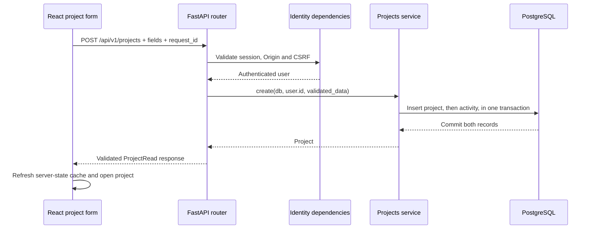

# Research Projects — code walkthrough and engineering decisions

This is the second working vertical feature. Read this alongside the files in `backend/app/modules/projects/` and `frontend/src/features/projects/`. Password recovery is deliberately deferred at the user's request; it remains a pre-public-release requirement, not a completed feature.

## Follow one request



The browser never decides who owns the project. The router passes the authenticated `user.id` into the service. This is the difference between **authentication** (who you are) and **authorization** (which resource you can act on).

## 1. Schemas: validate at the boundary

File: `backend/app/modules/projects/schemas.py`.

Pydantic schemas validate incoming JSON before business logic runs. Project titles are trimmed and bounded. Questions/objectives are lists with up to 20 nonblank entries, each up to 500 characters. Unknown input fields are rejected with `extra="forbid"`, so a caller cannot add an `owner_id` or rewrite a revision arbitrarily.

`ProjectCreate`, `ProjectPatch`, and `ProjectRead` serve different jobs. Input defaults can be useful, while output fields must accurately describe what the API always returns. Generated TypeScript caught an initially ambiguous response contract; explicitly required response fields fixed the contract rather than hiding the error with a type cast.

Frontend Zod validation provides immediate form feedback. Backend Pydantic validation remains authoritative because anyone can send an HTTP request without using our UI. The extra validation on both sides serves different trust boundaries; it is not a reason to trust browser input.

## 2. Models: let the database protect invariants

File: `backend/app/modules/projects/models.py`.

`ResearchProject` owns a UUID, owner foreign key, research details, revision, lifecycle timestamps and creation-request identity. `ProjectActivity` belongs to a project and records meaningful changes. A unique `(owner_id, create_request_id)` constraint prevents concurrent duplicate creates. A check constraint prevents invalid revisions. The owner/creation index supports scoped listing.

Questions and objectives are bounded JSONB arrays for now. This is simple while they are edited as one project form. If individual questions need stable links, their own permissions, evidence associations or independent revision history, introduce proper child entities through an additive migration. Do not force every string into a new table before it has its own lifecycle.

Foreign keys prevent dangling relationships; application authorization prevents another user's access. They solve different problems.

## 3. Services: make ownership unavoidable

File: `backend/app/modules/projects/service.py`, function `owned`.

```python
statement = select(ResearchProject).where(
    ResearchProject.id == project_id,
    ResearchProject.owner_id == owner_id,
)
```

Both conditions belong in the database query. We also exclude soft-deleted records. Every detail, update, lifecycle and activity operation passes through this ownership check. A guessed or copied UUID does not grant access. Returning the same 404 for an absent or foreign project avoids disclosing whether another user's project exists.

This is a small shared application function, not a complicated generic repository framework. A repository abstraction can become useful when queries grow or multiple persistence adapters exist; currently it would add indirection without solving a concrete problem.

## 4. Transactions: save the project and its activity together

File: `service.py`, functions `create`, `record` and `update`.

```python
db.flush()
record(db, project, "created", "Project created.", [])
db.commit()
```

`flush()` sends pending writes to PostgreSQL and assigns generated identifiers, but does not make the transaction final. `commit()` completes the unit of work. If recording the activity fails, closing/rolling back the session removes the pending project insert too. The test `test_failed_activity_rolls_back_project_creation` deliberately fails activity persistence and proves that neither record survives.

Tradeoff: a transaction holds database resources until it finishes. Keep this work short. Never place a slow AI call, PDF extraction, or external network request inside this project row-lock transaction.

## 5. Idempotency: a retry is not a second project

File: `service.py`, function `create`; frontend `project-form.tsx`.

The form keeps one random request ID for the same submitted payload across a failed-request retry. The backend fingerprints normalized project fields and checks whether that owner's request was already used. Same key/same payload returns the existing project. Same key/different payload returns 409. A database uniqueness constraint resolves two requests arriving at the same time.

The concurrency test uses two independent PostgreSQL sessions. It verifies one project and one activity entry, rather than merely mocking a successful API response.

This adds a small amount of state, but protects users when a network timeout makes the outcome uncertain. Disabling the submit button alone cannot handle a retry after a lost response.

## 6. Edit conflicts: protect the work in another tab

File: `service.py`, functions `check_revision` and `update`.

Each project begins at revision 1. The client submits its `expected_revision`. The service briefly locks the row, verifies that revision, updates fields, and increments the revision. The row lock makes the check-and-write safe under simultaneous requests; the revision check provides optimistic conflict detection for a stale form.

Example: both tabs load revision 1. Tab A saves and creates revision 2. Tab B's save still says revision 1, so the API returns 409. Its unsaved text stays in the form. The backend test proves two concurrent writers produce one success and one conflict.

Tradeoff: users may need to review and reconcile a conflict manually. This is preferable to silent data loss. Collaborative editing would require a different document-level strategy later; it is not needed for personal project settings.

## 7. Lifecycle: archive and deletion are different

An archived project remains visible through the Archived filter and is read-only until restored. This invariant lives in the service, not just in a disabled Edit button.

Removal is an explicitly confirmed soft delete. It sets `deleted_at`, hides the project from ordinary queries, and retains its record/activity. Repeated DELETE does not produce additional deletion events. The UI requires the exact title before enabling removal.

Tradeoff: retained records consume storage and require a real retention/purge policy before public release. Soft delete is not a backup and does not satisfy every erasure request. We do not yet offer recovery of a removed project in the UI. Keeping the record now protects future evidence relationships from premature cascading deletion.

## 8. Pagination: do not load every project forever

File: `service.py`, functions `encode_cursor`, `decode_cursor` and `list_projects`.

Lists use a bounded page size and a cursor based on immutable creation time plus UUID. The UUID breaks timestamp ties. The next query starts after the last item rather than repeatedly skipping a growing number of rows. Ownership, active/archive state and literal title search are applied before results are returned.

The cursor is not a permission token. Changing it cannot remove the owner filter. Search escapes SQL LIKE wildcard characters, so searching `%` means a literal percent sign. SQLAlchemy supplies bound parameters rather than concatenating untrusted SQL.

Tradeoff: cursor pagination is less convenient for jumping directly to arbitrary page numbers. “Load more” suits this personal-project list and avoids assuming a fixed snapshot while new projects are created.

## 9. Frontend state: separate server data from form drafts

TanStack Query owns fetched project lists/details/activity. React Hook Form owns unsaved form values. We refresh relevant queries after successful mutations. We do not copy project records into another global store or localStorage.

An edit form retains the revision it loaded. Background changes should not silently replace the text the user is editing. Errors stay near the form. Archived state and server conflict errors remain authoritative even if someone bypasses the UI.

Native semantic controls and a named modal dialog support keyboard operation. Component tests verify empty states, structured form data, retry identity, archive restrictions, retained conflict edits and deletion confirmation. The user still performs visual and real-device acceptance.

## 10. Why no Celery job here?

Creating a project is a short database operation. Doing it in the API gives immediate results and a simple transaction. Celery is reserved for work such as document extraction, embeddings and exports that genuinely needs independent execution and recovery. Background queues add delivery/retry/state complexity and should solve a real workload need.

## Read the code in this order

1. `schemas.py` — accepted inputs and returned contract.
2. `router.py` — the HTTP interface and injected dependencies.
3. `service.py` — ownership, invariants, transactions and lifecycle.
4. `models.py` and migration `0002_projects.py` — database structure and constraints.
5. `tests/test_projects.py` — examples of the behavior we promise, including attacks and failures.
6. Frontend `project-form.tsx`, `api.ts`, and `project-detail-page.tsx` — how the UI consumes that contract.

## Verification and remaining scope

Run backend lint/type checks and the disposable PostgreSQL/Redis test suite. Run frontend lint, strict types, component tests and production build. The local HTTP smoke then verifies the built app's proxy and real persistence. No browser screenshot automation is used.

This feature does not yet upload papers, run RAG, generate findings, or send password-reset emails. Password recovery, its real mail adapter, single-use expiry, generic account-discovery responses, rate limits and session revocation remain tracked before public release. The next research slice is the private PDF library and durable document processing.
